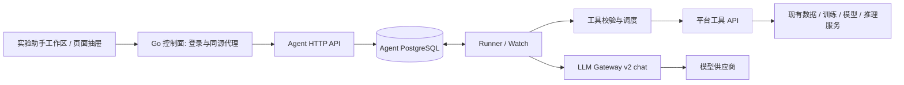

# FineVision Agent 服务架构与并发设计

更新：2026-10-25。本文描述已交付首版；实际配置、API 和验收命令见 [runtime.md](runtime.md)。

## 服务边界

Agent 是独立 Go 模块与 Docker 服务，首期一个进程组合 HTTP API、4 个 Runner 和 Watch。Compose 为其部署独立 PostgreSQL 容器、database、账号和 volume。Agent 通过平台 HTTP API 使用业务能力，不访问平台业务表，不导入控制面 internal 包，不执行 GPU 计算。

平台仍拥有用户、登录会话、数据版本、训练、模型、制品、外部操作和 Outbox。Agent 只拥有对话与执行状态；Gateway 复用现有模型供应商配置。各服务使用自己的本地事务，通过固定业务操作 ID 与结果查询衔接，不使用跨库事务。

## 组件和职责

| 组件 | 实现 | 职责 |
|---|---|---|
| 工作区与抽屉 | `frontend/src/features/agent` | 对话历史、证据、状态、确认、停止、跟踪与 SSE 重连 |
| 平台入口 | `go/internal/httpapi/agent_proxy.go` | 登录、CSRF、角色检查与可信身份转发 |
| Agent HTTP | `agent/internal/httpapi` | 按用户隔离会话、Run、事件、确认与 Watch |
| 状态模型 | `agent/internal/service` | 持久模型消息、轮次、用量、待执行工具、方案和结果 |
| 持久存储 | `agent/internal/storage` | 本库迁移、事务准入、请求去重、租约、检查点和事件 |
| 执行器 | `agent/internal/runner` | 显式模型与工具循环、上下文投影、预算、恢复和跟踪 |
| 工具层 | `agent/internal/tools`、`agent/api/toolcontract` | 15 个白名单工具、闭合 Schema、超时及有界读取 |
| 平台适配器 | `agent/internal/adapters/platform` | 受限委托、工具 HTTP、确认回执和操作对账 |
| 模型适配器 | `agent/internal/adapters/model` | Gateway v2 多轮消息与 tools 协议 |
| 业务工具入口 | `go/internal/httpapi/agent_tools.go` | 复用业务校验、签发确认、派发动作和裁剪输出 |

首版编排使用显式、可保存检查点的循环，不引入 Eino 执行内存。平台原有 Eino 数据卡片功能继续保留。服务公开协议包供控制面引用，其余实现保持模块隔离。

## 一次对话如何执行

1. 浏览器提交 conversation_id、request_key 和问题。平台代理验证登录与 CSRF，签发短期身份；用户不能通过请求体指定 owner。
2. Agent 在事务中校验会话归属、未完成任务和队列预算；同一请求键与内容返回同一个 Run，不同内容返回冲突。
3. Runner 领取 Run，写入租约与 epoch，恢复已有检查点，组装最近成功问答、当前工具链和用户可用工具。
4. 模型通过 Gateway 返回回答或工具提案。Registry 先检查完整批次的参数，再并行执行独立读取；结果带资源 ID、时间与证据保存。
5. 写提案先规范化并保存固定 operation ID，进入 waiting_confirmation。用户核对参数并点击确认后，平台签发绑定当前会话的回执。
6. Runner 保存派发意图后调用平台。成功保存结果，未知则查询业务事实；回答与持久事件经 SSE 展示，刷新可恢复。

取消 Agent Run 只停止后续分析。已经提交的训练继续由平台管理，需要另外确认取消训练工具或使用原平台操作。

## 数据和状态

Agent 表包括 conversations、runs、events、watches、agent_schema_migrations。Run 保存私有消息与执行 State；API 不直接暴露委托、回执或内部状态。表定义以 [SQL 迁移](../migrations/) 为准。

Run 在 queued、running、waiting_confirmation、waiting_auth 与终态之间转换。终态含 succeeded、failed、cancelled 和 unknown。数据库部分唯一索引约束同会话只有一个非终态 Run，等待确认或重新授权也保留会话次序。

模型派发前保存 model_pending；响应未知或进程恢复时不能自动再次计费，进入 unknown。只读工具允许恢复后重新查询。写工具派发前保存固定 operation ID 与 write_pending，响应未知先核对平台已存在的业务结果，不换 ID 重发。

60 秒租约每 5 秒续租，检查点通过 epoch 与 CAS 拒绝旧 Runner 写入。写业务本身仍由平台 operation ID 和业务唯一性保护；本库 fencing 不能终止已经发送到外部系统的请求。

## 并发与预算

| 层级 | 首版行为 |
|---|---|
| 会话 | 非终态 Run 串行，忙碌时返回 409 |
| 用户 | 最多 2 个运行 Run、8 个未完成 Run、8 个活动 Watch |
| Agent 全局 | 数据库调度最多 8 个运行 Run，queued/running 合计最多 128 |
| 首个容器 | 4 个 Runner，最多 16 个工具请求在途 |
| 工具批次 | 最多 4 个独立读取并行；带写动作只能单项执行 |
| Run 预算 | 最多 8 轮模型、24 次工具；观测用量达到 48000 tokens 后不再派发模型 |
| 上下文 | 最近 6 次成功问答，当前完整工具链；请求体上限 512 KiB |
| Gateway v2 | 单实例最多 8 个模型请求在途，无供应商自动重试 |
| 错分报告 | 单控制面最多并发读取 2 份，报告 16 MiB、类别 bundle 1 MiB 上限 |

数据库串行准入让多个 Runner 进程共享用户与全局限制。不同用户先取得首个槽，再使用用户剩余槽。工具 semaphore 和 Gateway 限制属于单进程限制，增加副本不会自动形成供应商全局 RPM/TPM 配额。

## 工具与证据

工具分为数据、训练、模型、骨干目录、Worker 容量和单样本推理，共 15 个，其中提交训练、取消训练和推理 3 个需要确认。[清单与契约](tools.md)。工具不能执行任意代码、SQL、宿主机路径或模型自报 URL。

测试集错分工具使用最终模型的独立 test 预测证据，报告 accuracy、macro-F1、易混类别、类别支持数和有限样本。Python Worker 保存证据，平台验证关联关系、SHA 与长度后读取，Agent 区分事实与原因假设。历史 val/test 混合报告不会冒充测试集，工具不读取原图，详见 [错分分析](test-error-analysis.md)。

模型上下文对大型列表做受控投影，完整证据保存在事件中；截断信息显式标记。模型输出以 Markdown 渲染，不执行 HTML，也不加载模型提供的图片。

## 训练跟踪

Watch 每 30 秒读取一次训练状态，最长 24 小时；等待期间不占模型槽。训练成功、失败或取消后保存结果并结束，用户点击「分析结果」再创建新分析。30 分钟后台委托到期进入 waiting_auth，用户恢复当前登录授权后继续；不会静默续签或自动重训。

## 当前边界与后续扩展

- Gateway 持久请求账本、供应商级跨副本 RPM/TPM 准入与结果查询尚未实现；未知模型请求不能自动恢复。
- 首版每次确认一个动作，不提供多实验批量确认或参数内联编辑。
- Watch 完成后由用户触发模型分析；尚无自动实验迭代、多专家或 API/Runner 分容器部署角色。
- Agent 本库启动迁移使用本库账号；生产迁移/运行角色拆分、内容保留清理与备份运维需要另行配置。
- Agent 会话按用户隔离，平台业务资源继续沿用既有权限规则，不声称所有业务接口已实现用户级资源隔离。

以上属于后续工作，不能据此视为当前功能。测试覆盖与部署顺序见 [实施记录](implementation-plan.md) 和 [运行说明](runtime.md)。
